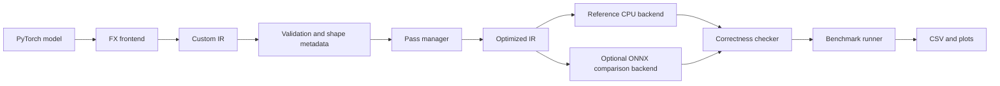

# Technical Project Blueprint

## 1. Final architecture



The compiler owns the IR and optimization decisions. PyTorch FX is used for graph extraction, not as the project's optimization engine. External runtimes are comparison or execution backends only.

## 2. Repository structure

```text
compiler/
  frontend/       PyTorch FX import and operator registry
  ir/             Node, Tensor, Graph, validation
  optimizer/      pass manager and graph transformations
  quantization/   FP16, INT8, calibration (planned)
  backend/        reference CPU execution and optional export
  runtime/        execution contracts (planned)
benchmarks/       repeatable timing and memory measurements
configs/          machine-readable experiment configurations
experiments/      experiment entry points and analysis
visualization/    graph and benchmark plots
results/          generated CSV/JSON/figures
scripts/          reproducible command wrappers
tests/            unit and integration tests
docs/             architecture and research notes
```

Current implementation includes the initial `compiler/`, `tests/`, `visualization/`, `benchmarks/`, `configs/`, `experiments/`, `results/`, and `scripts/` slices. Weight-only INT8, activation range calibration, numerical-error reporting, and a controlled torchvision workload harness are implemented; export and full large-workload coverage remain future milestones.

The optional GUI is implemented as a Windows-friendly Tkinter workbench in `compiler/gui.py`. It invokes the same compiler APIs as the CLI, exposes workload, precision, and optimization-pass controls, and supports compilation summaries, benchmarking, and IR JSON export.

## 3. Custom IR specification

`Graph` owns named `Node` and `Tensor` objects plus ordered input/output tensor IDs. A `Node` stores `node_id`, `operation`, input/output IDs, attributes, parameters, and metadata. A `Tensor` stores shape, dtype, producer, consumers, optional constant value, and input/output flags.

Invariants:

- Every node input and output references an existing tensor.
- Each produced tensor has exactly one producer; graph inputs and constants have no producer.
- Producer and consumer links are symmetric.
- Declared boundary tensors exist.
- The graph is acyclic for the current execution model.
- Validation runs after import and every pass.

## 4. Supported operator subset

Implemented vertical slice: `Linear`, `ReLU`, `Conv2d`, `BatchNorm2d`, `MaxPool2d`, `AvgPool2d`, `Flatten`, `Add`, and `Mul` where FX can expose them. Constants are represented as tensors. Unsupported modules/functions raise `NotImplementedError` with the operator name.

Next controlled expansion: `Flatten`, `Conv2d`, `BatchNorm2d`, pooling, `MatMul`, `Reshape`, and `Transpose`. Each addition requires importer, backend, shape, and equivalence tests.

## 5. Compiler pass architecture

`PassManager` registers named callables and returns per-pass statistics. Every pass mutates only the custom graph and validates its result before the next pass.

Current passes:

- Constant folding: fold `Add`/`Mul` when all inputs are compile-time constants.
- Dead-node elimination: reverse-traverse from graph outputs and remove unreachable nodes.
- Redundant operation elimination: remove scalar `x + 0` and `x * 1` only when the identity precondition is explicit.
- Conv-BatchNorm-ReLU fusion: fold inference BatchNorm parameters into Conv2d and preserve ReLU semantics.

Fusion currently targets inference-mode graphs with fixed convolution parameters; training graphs and dynamic control flow remain rejected or unsupported.

## 6. Backend strategy

The first backend executes the custom IR using PyTorch tensor kernels as a transparent reference backend. This isolates graph correctness from kernel implementation. A later CPU backend may lower supported ops to NumPy or optimized libraries; ONNX Runtime will be a controlled comparison, never the compiler itself.

## 7. Benchmarking methodology

Each experiment records model, input shape, batch size, dtype, pass configuration, hardware/software versions, warmups, measured iterations, seed, compilation time, latency distribution, throughput, peak RAM, serialized size, accuracy, and numerical error. Measurements use warm-up runs, repeated timed runs, fixed thread settings, and machine-readable JSON/CSV output. No improvement is claimed without measured comparison.

The current `scripts/run_ablation.py` command demonstrates the persistence workflow with baseline and optimized MLP configurations. It is infrastructure validation, not a final performance study.

Ablations: baseline; each graph pass independently; all graph passes; FP16; INT8; and combined configurations. Results must include failed or neutral transformations.

## 8. Testing strategy

Unit tests cover IR insertion, links, validation failures, traversal, each pass, and unsupported operators. Integration tests cover PyTorch model -> importer -> validation -> pass manager -> backend -> output comparison. Numerical tolerances are dtype-specific. Property-based malformed-graph tests may be added after the core contracts stabilize.

## 9. Development milestones

1. **Foundations:** package, custom IR, validation, deterministic MLP vertical slice. **Complete.**
2. **Importer breadth:** operator registry, shape/dtype propagation, controlled CNN support. **Current.**
3. **Optimization engine:** pass manager, constant folding, dead code, redundant ops, fusion.
4. **Execution and precision:** CPU reference execution, FP16 conversion, and symmetric weight-only INT8. Activation calibration remains future work.
5. **Evaluation:** benchmark runner, plots, ablations, ResNet-18/MobileNet workloads.
6. **Research finalization:** reproducibility metadata, limitations, report, and optional ONNX comparison.

## 10. Risks and mitigations

- **FX tracing limitations:** document supported model patterns and reject dynamic/control-flow cases clearly.
- **Incorrect rewrites:** validate IR and compare outputs after every pass in tests.
- **Misleading speedups:** pin threads, warm up, repeat measurements, and report distributions.
- **Scope creep:** defer GPU, Transformer, learned cost models, and GUI until CNN evaluation is stable.
- **Quantization accuracy loss:** use calibration subsets and report accuracy/error trade-offs rather than assuming gains.
- **Student hardware variability:** record environment metadata and separate compiler overhead from inference latency.

## 11. Dependencies

Required: Python 3.10+, PyTorch CPU, pytest. Planned optional dependencies: NumPy, pandas, matplotlib, psutil, and ONNX Runtime. Optional dependencies should be added only when the corresponding milestone begins.

## 12. Initial environment setup

```powershell
python -m venv .venv
.\.venv\Scripts\Activate.ps1
python -m pip install -r requirements.txt
pytest
python -m compiler.demo
```

## First three implementation tasks

1. Add INT8 calibration and numerical-error reporting.
2. Add ResNet-18/MobileNet controlled workload experiments.
3. Add plot generation and optional ONNX Runtime comparison.

## Smallest end-to-end milestone

The current milestone is: deterministic PyTorch MLP -> FX importer -> custom IR -> validation -> dead-node elimination -> reference backend -> numerical comparison. Constant folding is also covered independently with a synthetic IR test so the first optimization has a compile-time-only case that is easy to reason about.
